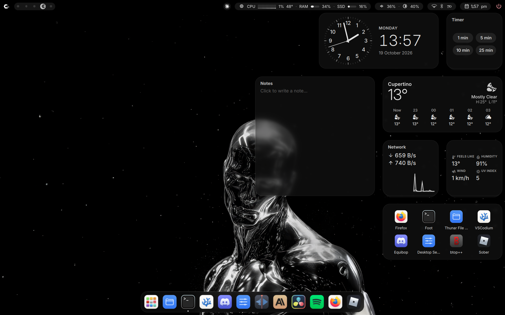
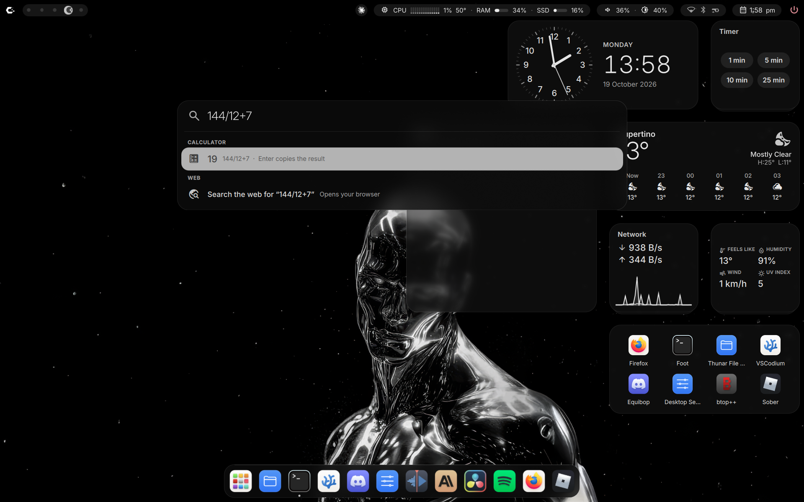
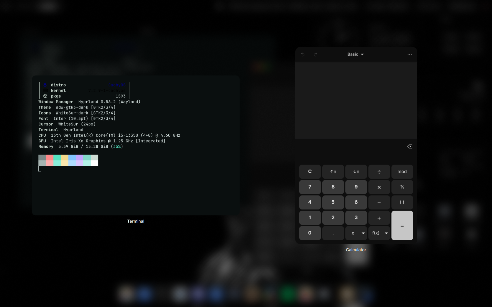
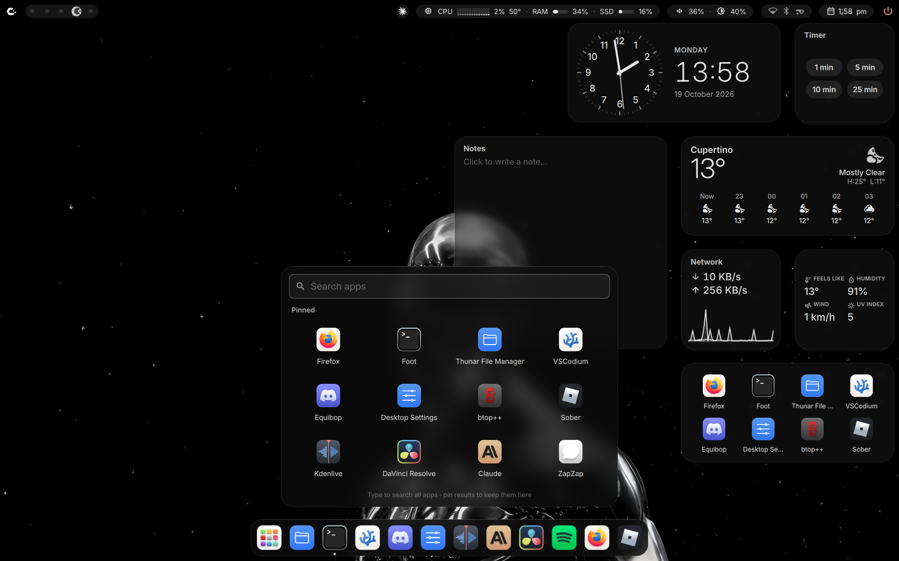
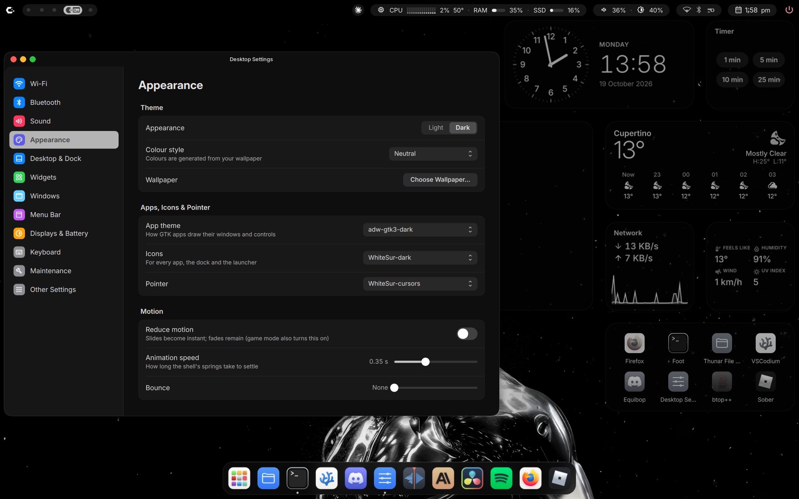
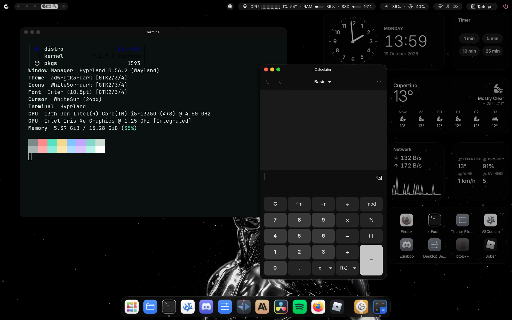

# macOSxCaelestia

A macOS-style Hyprland desktop in one file: a top bar with floating pills, a permanent dock,
Spotlight, desktop widgets, a Mission-Control-style Overview, title bars with traffic lights and
frosted glass. Built on Hyprland (Lua config), the Caelestia shell and Quickshell.

## Install

On a fresh CachyOS with KDE Plasma, open a terminal and run:

```sh
curl -LO https://github.com/exploitgamers/macOSxCaelestia/releases/latest/download/macOSxCaelestia.run && bash macOSxCaelestia.run
```

It shows the plan, asks once and takes 5-10 minutes. Then **log out and pick Hyprland** on the
login screen. Plasma stays as it was; switch back to it at the login screen any time.

## Screenshots








## Options

| Option | What it does |
|---|---|
| `--yes` | don't ask |
| `--dry-run` | print every step, change nothing |
| `--uninstall` | remove the installed config files and put your old ones back (packages stay) |

Example: `bash macOSxCaelestia.run --dry-run`.

## Requirements

CachyOS (recommended) or Arch Linux, x86-64, a user with sudo, an internet connection. On any other
system the file offers to download the latest CachyOS ISO, check its sha256 and write it to a USB stick
you choose; install CachyOS with **KDE Plasma**, then run the file again.

## What it changes

- **Packages:** `sudo pacman -Syu --needed …` (Hyprland, foot, fish, Firefox, Thunar, fonts, PipeWire tools…;
  this also updates your system), then `sudo pacman -U …` for the AUR packages bundled inside the file, so
  nothing is compiled (Caelestia shell and CLI, HyprMod, qtengine, Darkly, WhiteSur icons and cursors…).
- **Your home folder:** `~/.config/{hypr,caelestia,quickshell,foot,fish,fuzzel,gtk-3.0,gtk-4.0,nwg-look,Thunar,qtengine,btop}`,
  Thunar's `thunar.xml`, `~/.gtkrc-2.0`, `~/.config/starship.toml`, the `rice-*` helpers in `~/.local/bin`,
  Quickshell in `~/.local/opt/quickshell-local`, the title-bar plugin in `~/.local/lib/hyprland/plugins`,
  a wallpaper in `~/Pictures/Wallpapers` and a userChrome.css in Firefox's default-release profile.
- **Backups:** every file it replaces is first copied to `~/.local/state/macOSxCaelestia-backup-<date>/`; running it
  again keeps your edits in `macOSxCaelestia-replaced-<date>/`. `--uninstall` puts them back.
- **Shared with Plasma:** the GTK theme (`gtk-3.0`, `gtk-4.0`, `~/.gtkrc-2.0`, `org.gnome.desktop.interface` gsettings),
  Thunar's preferences and the fish, foot, starship and btop configs. System Settings, the Thunar/AppImage/GTK
  settings apps and Background Services (uuctl) leave the app menus (Plasma's too); they open from
  Desktop Settings > More. Nothing system-wide is changed.

## After logging in

- Super+Space: Spotlight · Super+I: Desktop Settings · Super alone: app launcher.
- `rice-doctor`: health check (Quickshell/Qt match, title-bar plugin, shells running).
- Weather uses your IP location; set a city in `widgets.weatherLocation` in `~/.config/caelestia/macos.json`.

## Updating

Run the install command again: the newest `macOSxCaelestia.run` carries the current packages and configs, and your
edits to installed files are kept aside (see Backups). This repository is history only (`git log -p payload/`);
it leaves out the built file and the bundled packages, so a clone alone can't install anything.

## Known limits

- **Qt drift:** Quickshell is built for Qt 6.12. With a newer Qt the installer warns and switches to the repo
  `quickshell` if that one matches; otherwise Quickshell must be rebuilt from source.
- **Hyprland drift:** the title-bar plugin only loads into the Hyprland it was built for. If yours differs, the
  installer rebuilds it (about a minute); if that fails, windows have no title bars and everything else works.
- **Python drift:** caelestia-cli and HyprMod are packed for Python 3.14.
- Bundled AUR packages carry the versions of the build date; update them from the AUR later if you like.
